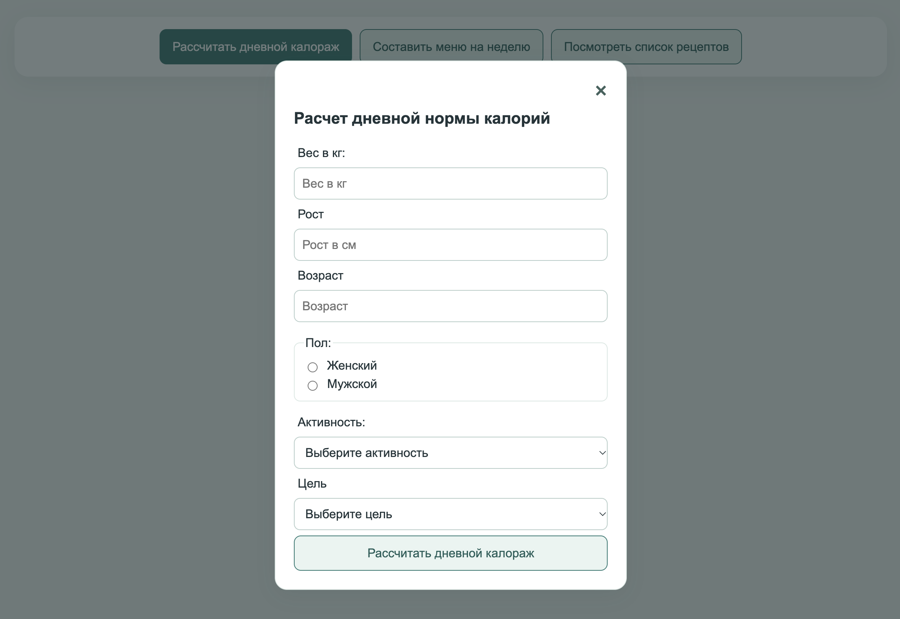
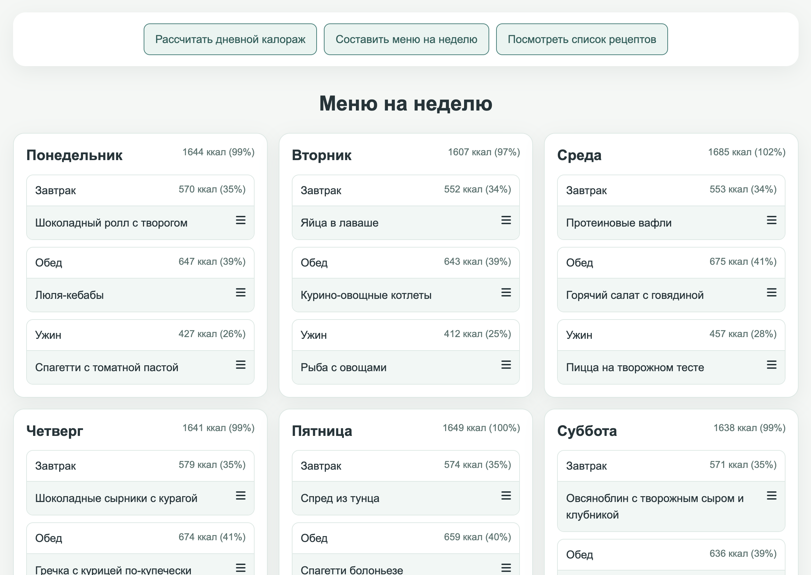
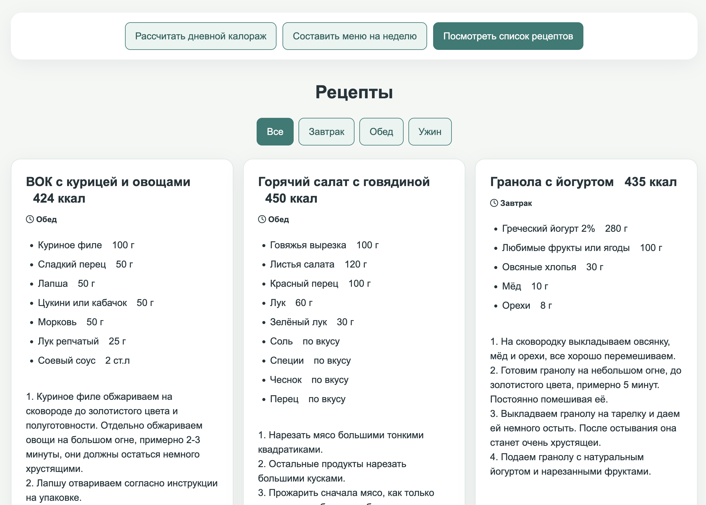

# Diet Constructor

A Vue.js application for estimating a daily calorie target and creating a seven-day meal plan from a built-in recipe collection.

Originally built as a practice project focused on Vue components, interactive forms, and client-side state.

## Preview

[Live demo](https://petrunenkovas.github.io/DietConstructorVue/)

<table>
  <tr>
    <th>Calorie calculator</th>
    <th>Weekly menu</th>
    <th>Recipes</th>
  </tr>
  <tr>
    <td></td>
    <td></td>
    <td></td>
  </tr>
</table>

## Features

- Estimate a daily calorie target based on personal inputs and activity level
- Generate a seven-day meal plan from 47 built-in recipes
- Browse recipes and filter them by meal type
- Save the calorie target in the browser

## Tech Stack

- Vue 2
- JavaScript
- HTML / CSS
- webpack 3

## Technical Highlights

- Client-side recipe data and meal generation
- Portion scaling for the selected calorie target
- Local storage for the calorie target

## Getting Started

Clone the repository and install dependencies.

```bash
npm install
npm run dev
```

## Project Status

This is an early learning project that retains its original Vue 2 stack.

The repository is preserved as part of my development history. Later improvements are listed below.

## Improvements

- Refreshed the interface and improved the layout on smaller screens
- Added input validation and prevented menu generation without a valid calorie target
- Prevented meal generation from changing the original recipe data
- Made recipe details easier to open from the weekly menu
- Corrected asset paths for deployment under the GitHub Pages repository URL
- Added screenshots to the README preview
